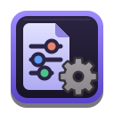

<p align="center">
  
</p>

# nuvek-agent-config

[](https://github.com/jean1880/nuvek-agent-config/actions/workflows/ci.yml)
[](LICENSE)

One authored source of instructions for the coding agents you use: Claude Code, Antigravity (`agy`) and
Codex. You write rules, skills, agents, MCP servers, permissions and hooks once, in this repository.
[`agent-sync`](https://github.com/jean1880/nuvek-agent-sync) renders them into each tool's own
configuration and tells you when a tool has drifted from the source.

This repository is a starter: generic engineering skills and a template for the shared rules. It holds no
machine-specific facts. Clone it, customise `rules/core.md`, and make it yours.

## Highlights

- **Write once, run in three tools:** Claude Code, Antigravity and Codex.
- **Generic skills** for delegation, Rust, security, Git and releases, with tool-neutral wording.
- **Drift gate:** `agent-sync check` exits 6 when a tool no longer matches the source.
- **No machine-specific facts:** placeholders and an optional private overlay hold those.

## Layout

The projection diagram (which source file feeds which tool) and the skill inventory are in
[docs/layout.md](docs/layout.md).


| Path | What it holds |
|---|---|
| `.claude-plugin/plugin.json` | The `nuvek-skills` plugin manifest (Agent Skills standard) |
| `skills/<name>/SKILL.md` | The skills, with optional `references/` for on-demand detail |
| `rules/core.md` | The shared global mandates, written as a template to customise |
| `rules/claude.md`, `agy.md`, `codex.md` | Per-tool overlays (model tiers, tool names) |
| `rules/memory-pointer.md` | A pointer that lets AGY read Claude's native memory |
| `sync/agents/` | Neutral agent definitions |
| `sync/map.toml` | The translation table: tiers, tool names, placeholders |
| `sync/mcp.toml`, `permissions.toml`, `hooks.toml` | Required by `agent-sync`; shipped minimal and valid |
| `sync/*.example` | Fuller examples to copy from: MCP servers, permissions, hooks, model tags |
| `sync/models.toml.example` | Optional. Copy to `models.toml` to enable model-tag projection |
| `scripts/` | Repository checks used by CI and the pre-commit hook |

Never add `agents/`, `commands/` or `hooks/` at the repository root. The root is also the Claude plugin
root, and Claude loads those directories there as plugin components, which would duplicate the generated
agents. Neutral sources live under `sync/` for that reason.

## Skills

Eight generic skills (delegation, Rust, polyglot scaffolding, skill authoring, security, Git, releases
and shared-library review) and four reviewer agents ship in the box. The inventory is in
[docs/layout.md](docs/layout.md#skills). Optional integrations such as `cross-agent` and hive-board are
never required.

## Use it

1. Clone and enter it:

   ```bash
   git clone https://github.com/jean1880/nuvek-agent-config.git
   cd nuvek-agent-config
   ```

2. Customise `rules/core.md`. Search for `customise:` markers: each one is a place that needs a fact
   about your environment. Do the same in the overlays and in the skills that carry a marker.
3. Install `nuvek-agent-sync`, which provides the `agent-sync` binary
   (see https://github.com/jean1880/nuvek-agent-sync for releases and install steps).
4. Point it at this checkout and check:

   ```bash
   export AGENT_CONFIG_DIR="$PWD"
   agent-sync check
   ```

   A fresh machine reports drift for every surface that is not rendered yet. That is expected.
5. Render the projections:

   ```bash
   agent-sync apply
   agent-sync check
   ```

   The second check must exit 0. Start a new session in each tool to load the result.

To enable MCP servers, permissions or hooks beyond the minimal defaults, copy entries from
`sync/mcp.toml.example`, `permissions.toml.example` and `hooks.toml.example` into the matching file, then
`apply`. A `${NAME}` placeholder in a source (such as `${PROJECTS_DIR}` in the filesystem server) is
expanded only if `NAME` is listed in `sync/map.toml` `placeholders`, and rendering fails when it is unset:
export an absolute path first (`export PROJECTS_DIR="$HOME/projects"`). The default `permissions.toml` is
read-only; the build and test grants are an opt-in block, because they run a repository's own code. `agent-sync` refuses to write anything that looks like a secret, and MCP entries reference secrets
as `$VAR` inside a `bash -c` wrapper rather than as literals.

`agent-sync` links the plugin inside `~/.claude` under the `name` in `.claude-plugin/plugin.json`
(`nuvek-skills` here). Rename it there if you want your own plugin name.

### Recovery

If a projection breaks an agent, undo the source with `git revert <sha>`, run `agent-sync apply`, then
`agent-sync check`. A projection you edited by hand is overwritten by `apply`, which keeps the previous
copy as `<file>.agent-sync.bak`. `apply` refuses AGY's settings while `agy` is running: quit it first.

## Private overlay

Keep your hosts, addresses and personal rules in a separate private checkout and layer it over this
one with `agent-sync --overlay <path>` (or `AGENT_SYNC_OVERLAY`). The overlay's files win path by
path, and its TOML sources merge by key. See the
[overlay documentation](https://github.com/jean1880/nuvek-agent-sync/blob/master/docs/overlays.md).
Keep private facts out of this repository: use `${PLACEHOLDER}` names and put the values in your
environment.

## Troubleshooting

- **`agent-sync check` exits 6 on a fresh machine:** nothing is rendered yet. Run `agent-sync apply`.
- **Rendering fails on a `${NAME}`:** `NAME` is listed in `sync/map.toml` `placeholders` but unset.
  Export it first.
- **`apply` refuses Antigravity's settings:** `agy` is running. Quit it, or pass `--force`.

## Related projects

- [nuvek-agent-sync](https://github.com/jean1880/nuvek-agent-sync): the `agent-sync` renderer for this source
- [nuvek-cross-agent](https://github.com/jean1880/nuvek-cross-agent) and
  [nuvek-agent-terminal](https://github.com/jean1880/nuvek-agent-terminal): cross-harness delegation
- [nuvek-hive-board](https://github.com/jean1880/nuvek-hive-board): a board for coordinating agent teams
- [nuvek-core](https://github.com/jean1880/nuvek-core): the shared Rust library behind them

## Contributing

See [CONTRIBUTING.md](CONTRIBUTING.md) and [AGENTS.md](AGENTS.md). CI runs markdownlint, a TOML parse check,
gitleaks and a check that no private deployment details have crept in.

## Support

If agent-config saves you time, you can support its development:

- [Ko-fi](https://ko-fi.com/jean1880)

## Licence

Released under the [MIT Licence](LICENSE). Copyright (c) 2026 Jean-Luc Desroches.
